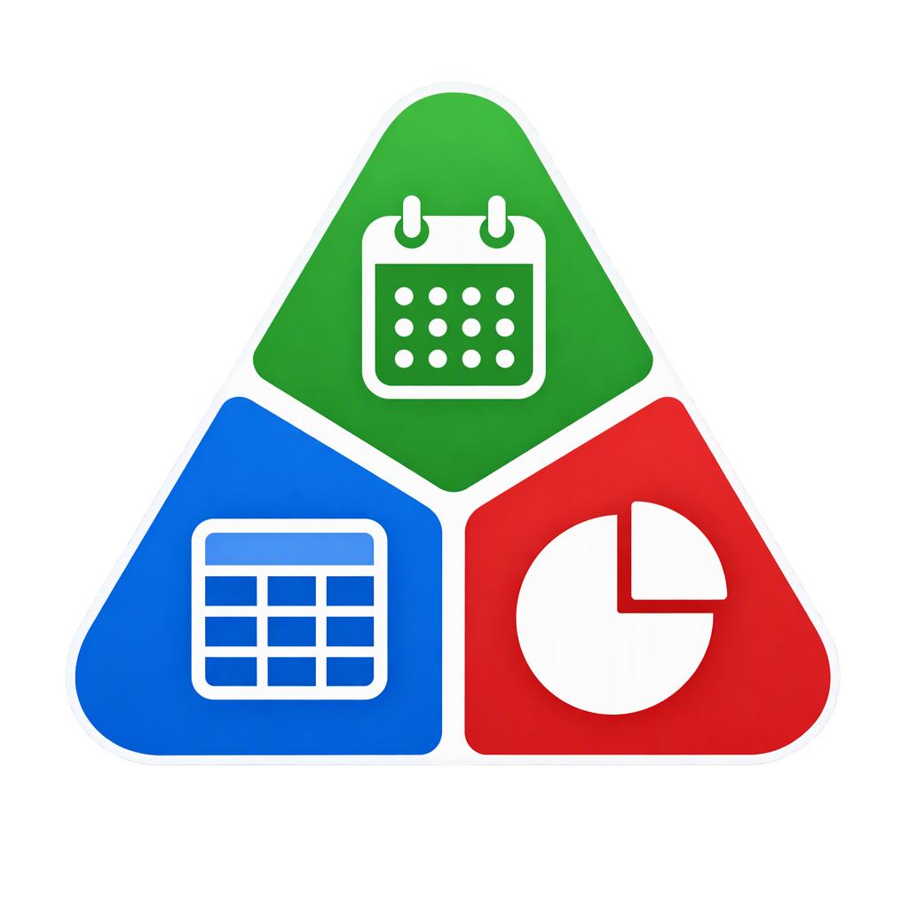
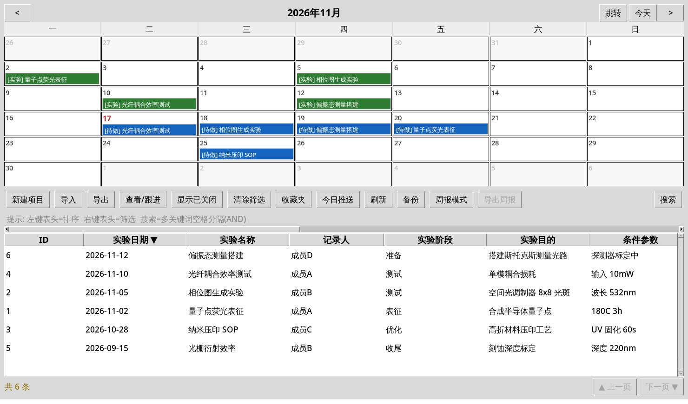
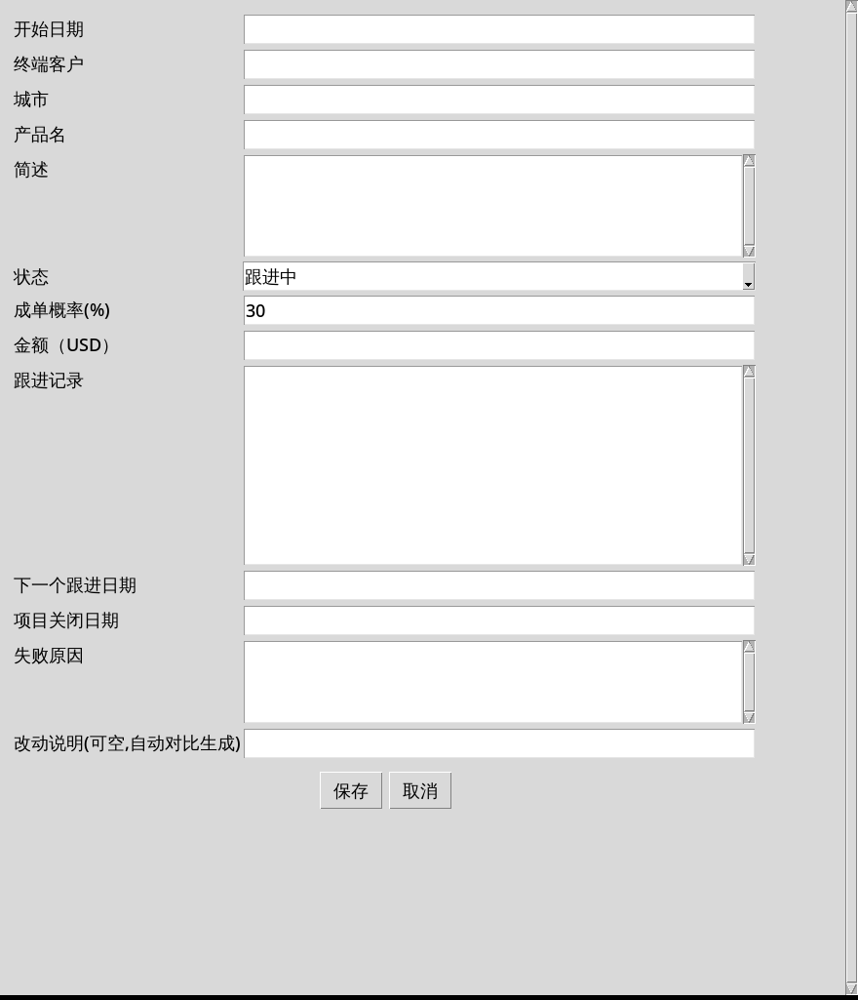
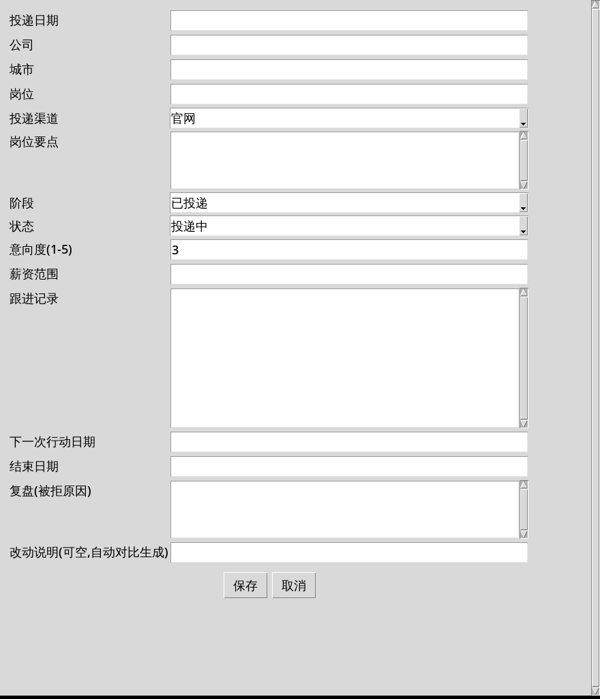
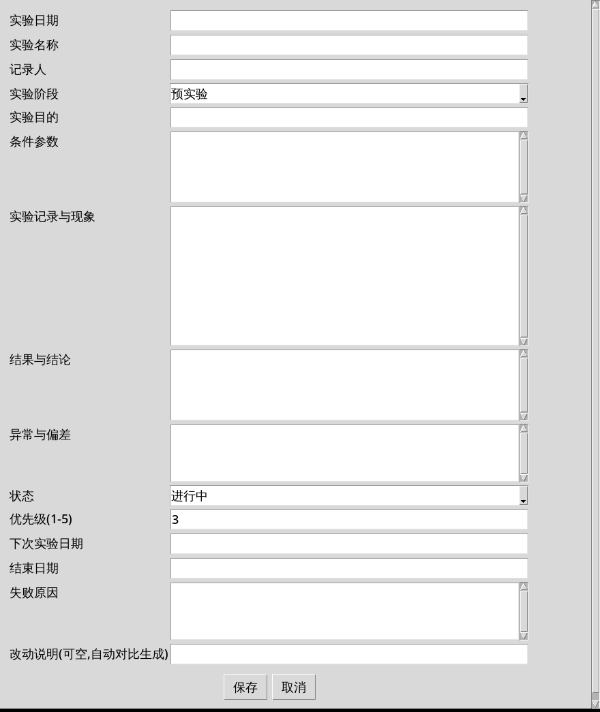
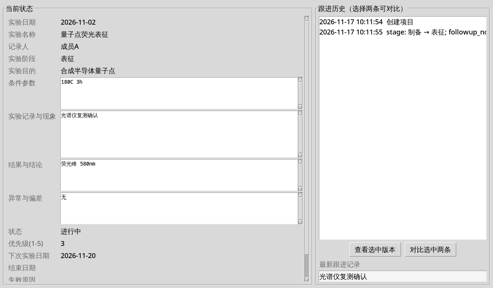
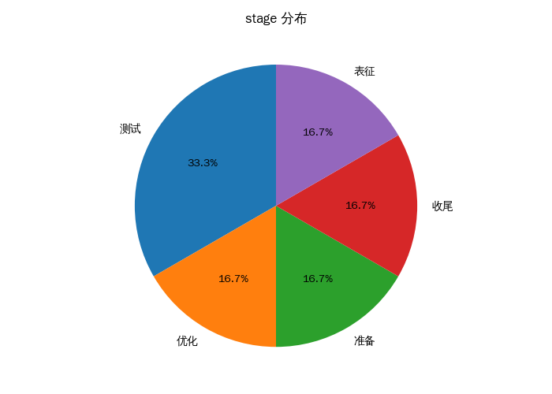
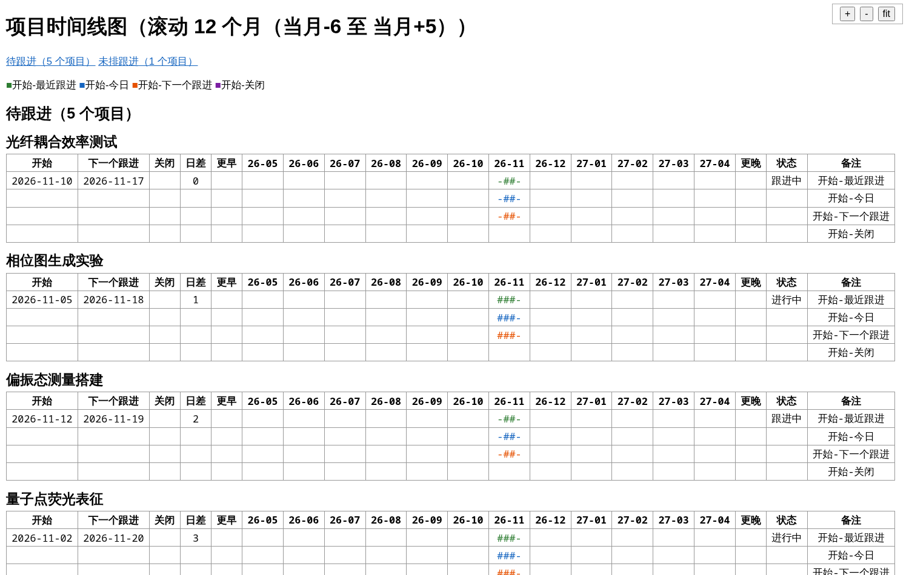

# 日历表格聚合项目跟进工作台 v3.16.1



**面向大量并行项目的轻量级跟进工作台。** 所有项目数据存在**一个
SQLite 数据库 .db 文件**里——复制即备份，任何 SQLite 工具可打开，
不注册、不联网、不上传。

让记录融入工作：每次跟进存一条完整快照——谁改的、改了什么、
什么时候、为什么，永久可查，任意两版红字对比。

- 数据 = 单个 `.db` 文件；30 万条实测启动约 5 秒
- 一个项目可挂多个日期（开始/跟进/关闭/自定义），日历上点击直达
- 表格内容全部由 `fields.json` 配置，**改配置不改代码**
- 七件套工具：复制 / 追加 / 分拆 / 赋值 / 周报清洗 / 分析 / 回收站
- 软件免费开源（MIT），基于 git 版本控制开发

**联系作者：zifeng.xu@foxmail.com**（BUG 报告 / 功能讨论 / 捐赠与
模板定制咨询；业余时间开发，BUG 会尽快修复）

---

## 一、安装与启动

需要 Python 3.8+（python.org 官方版，自带 tkinter）。
实测 3.8 ~ 3.14 stable 可顺利安装运行；**3.15 目前 pip 直接装不上**
**依赖，暂不建议使用**。

```bash
# 1. 解压后进入文件夹。部分旧环境需先升级打包工具链：
pip install --upgrade pip setuptools wheel

# 2. 安装依赖（Excel 导入导出 + Windows 通知）
pip install -r requirements.txt

# 3. 启动
python main.py
```

数据文件首次启动自动创建，与程序同目录。

排障：装依赖报 `Failed building wheel for winrt-runtime` = Python 太新
（如 3.15）没有预编译 wheel，改用 3.8~3.14 或按 requirements.txt
注释换备选通知库 `win10toast`。打包成 exe（可选）：装好 PyInstaller
后运行 `build_exe.ps1`（PowerShell），dist 目录整个拷走即用。

## 二、让 AI 帮你部署和安装

不会装环境也没关系——把下面这段提示词发给任意 AI Agent
（Kimi、ChatGPT、Claude、Cursor 等），它会帮你完成下载、装依赖、
启动和排障：

```text
请帮我部署 pm_workbench（日历表格聚合项目跟进工作台）：
1. 从仓库获取源码（Gitee: https://gitee.com/xu-zifeng/cal-sheet-combine-management-framework
   或 GitHub: https://github.com/xzf89718/calendar_sheet_integrated_project_manager.git）；
2. 按仓库 README.md 的「安装与启动」一节安装依赖并启动（需要 Python 3.8~3.14）；
3. 启动失败时阅读报错并修复，可参考 README 的排障段落与 FIELDS-CONFIG.md；
4. 部署完成后告诉我：如何启动、数据文件在哪、如何备份。
```

仓库地址（手动下载用）：

- Gitee：https://gitee.com/xu-zifeng/cal-sheet-combine-management-framework
- GitHub：https://github.com/xzf89718/calendar_sheet_integrated_project_manager

> **免责声明**：AI 会在你的机器上执行命令，关键操作（删除、覆盖、
> 修改系统配置）请自行核对后再放行；作者不为 AI 执行结果导致的
> 问题负责。发给 AI 的上下文可能包含你的业务信息——**敏感信息
> （客户隐私、个人身份信息、薪资、未公开业务数据）不要发给 AI**；
> 软件本身不联网、不上传任何数据，但发给第三方 AI 服务的内容
> 离开本机后不受本软件控制。

## 三、基本使用（零基础从这里开始）

### 主窗口：三块



- **上半：日历**——跟进表模式显示开始/跟进/关闭等日期（默认绿/蓝/红），
  周报模式显示追加记录（紫）
- **中间：按钮行**——新建、导入导出、查看、备份、模式切换、收藏夹、搜索
- **下半：项目列表**——列由配置决定，每列可排序可筛选，超页自动翻页

日历/列表的全部手势（表头左键排序、右键筛选、多选、翻页……）见
[workbench_ui/README.md](workbench_ui/README.md) 的「界面总览」。

### 三个现成形态：换 JSON 即换软件

表单字段、列、状态全部由 `fields.json` 决定。同一份代码，换一份
JSON 就是另一个软件——三个现成形态的新建表单：

**销售项目管理（默认）**



**求职投递**



**实验记录本**



切换方法三分钟搞定（复制 example 里的文件改名为 fields.json），
见 [example/README.md](example/README.md)；想定义自己的形态见
[FIELDS-CONFIG.md](FIELDS-CONFIG.md)。

### 新建与跟进

「新建项目」填表保存（项目名自动生成 = 配置字段按序拼接）。之后
每次有新进展：打开项目 →「编辑/添加跟进」→ 改字段、写跟进记录 →
保存 = 生成一条**完整快照**。改动说明留空会自动生成
（如"阶段: 制备 → 表征"）。

### 追溯（本软件的核心）



打开项目详情：**当前状态**显示所有字段最新值；跟进历史里选中一条
可查看旧版本整版快照；选中两条逐字段红色高亮对比，跟进记录全文
对照。**删除项目**进回收站可恢复（见 db_recycled/README.md）。

### 周报模式与导入导出

点「周报模式」：日历与表格改显每天的追加记录（紫），「导出周报」
按两行日期区间合并导出一个 xlsx 的两个工作表（本周跟进 + 下周
计划）。「导入」选模板选文件（xlsx/csv，一行 = 一个项目）；「导出」
只导出列表筛出的，按后缀生成 xlsx 或 csv（utf-8-sig，Excel 双击
中文不乱码）。细节见
[workbench_ui/README.md](workbench_ui/README.md)。

## 四、分析：饼图与时间线

```bash
python -m db_analysis pie --field 阶段        # 分布饼图（PNG + 数据 CSV）
python -m db_analysis timeline --split        # 项目时间线（HTML，可缩放）
```




筛选、日期窗、多变量同图等完整用法见
[db_analysis/README.md](db_analysis/README.md)。本地一键跑批：
`python scripts/runmyanalysis.py`（用法见
[scripts/README.md](scripts/README.md)）。


## 五、更多文档

| 想看什么 | 去哪看 |
|----------|--------|
| 三个产品形态（销售/求职/实验，换形态教程） | [example/README.md](example/README.md) |
| fields.json 逐条配置详解 + SQL 速查 | [FIELDS-CONFIG.md](FIELDS-CONFIG.md) |
| 命令行工作台（全部 GUI 功能的 CLI 版）+ 界面/日历/列表操作详解 + 启动选项/品牌图标 | [workbench_ui/README.md](workbench_ui/README.md) |
| 复制 / 追加 / 分拆 / 赋值 / 周报清洗 / 分析 / 回收站 | 各模块目录内 README.md |
| 开发者脚本（文档体检/文档构建/一键分析/图标重采样） | [scripts/README.md](scripts/README.md) |
| 全部版本更新历史 | [CHANGELOG.md](CHANGELOG.md) |

## 六、设计哲学（简写）

**起点是对 Excel 项目管理的反思**：消耗精力的不只是项目本身，
还有记录、查找、更新、回顾这些信息管理工作。三个主张：

1. **让记录融入工作**——在工作发生的时刻就记录，让记录足够快、
   足够顺，而不是事后重建。
2. **让软件承担信息汇总**——导入、日常记录、历史、日历/表格视图、
   周报导出构成闭环，周报是日常记录的自然产物。
3. **历史追溯是低频但重要的兜底**——历史不为翻旧账，而是异常、
   复盘时保留查清"为什么变了"的可能。

日历管时间安排与跟进节奏，表格管查看、搜索、筛选、汇总——时间
维度和集合维度两种理解工作的方式。本工作台服务"异步共享"的扁平
团队：不做实时协作与并发写入，价值由真实用户的长期使用检验。

---

LICENSE: MIT（Copyright (c) 2026 Ken）。开发历史由 git 管理，
Gitee/GitHub 双远程仓库同步。
